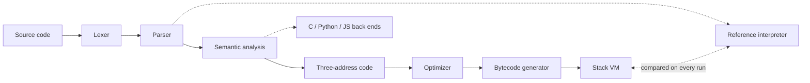

# Native Language Compiler

A teaching compiler for a small beginner language whose **keywords can be written in a
student's own language**: Tamil, Hindi, Telugu, Kannada, Malayalam, Bengali, Marathi or
English. It compiles programs through every classic phase, from tokens to a stack virtual
machine, and shows each phase on screen so students can see what happens inside a compiler.
Around it sit the teaching tools: a step-through debugger, friendly errors, C / Python /
JavaScript output, a time and space complexity advisor, and an optional AI tutor whose
code suggestions are checked by the compiler.

```
மாறி total = 0;
சுழற்சி (மாறி i = 1; i < 4; i = i + 1) {
    total = total + i;
}
பதிப்பி("total = " + total);      // prints: total = 6
```

## Highlights

- **A real compiler.** Lexer → parser → semantic analysis → three-address code → optimizer →
  bytecode → stack VM. A reference interpreter runs alongside on every run, and the results
  are compared, so a compiler bug can't go unnoticed.
- **Keywords in 8 languages.** Switch all ten keywords in one click, and convert existing code
  between languages. Variable names can use any script.
- **See every phase.** Tokens, syntax tree, symbol table, TAC, optimizer changes and bytecode,
  each in its own tab. Click a source line to follow it through all of them.
- **Step-through debugger** with time travel, the stack, memory and the call stack, and a
  plain-language explanation of every instruction.
- **Friendly errors** that name the phase, point at the exact spot, and suggest a fix
  ("Did you mean 'total'?").
- **C, Python and JavaScript back ends** that keep this language's rules.
- **Complexity advisor:** Big-O from the code, growth measured on the VM, the busiest lines,
  and faster rewrites that are checked to give the same output.
- **AI tutor (optional):** explains errors, lines and complexity in the student's language,
  using facts the compiler has already worked out.
- **Works on phones and laptops.**

## Quick start

You need [Node.js](https://nodejs.org) 20.19 or newer (22 recommended).

```bash
npm install
npm run dev        # open the address it prints
```

Press **Enter Interpreter**, type a program, and press **Compile & Run** (**Run** on a phone).
The **Syntax & Help** button has a guide with examples you can load with one click.

| Command | What it does |
|---|---|
| `npm run dev` | Starts the app, with the AI tutor if a key is set up |
| `npm test` | Runs all 120 tests |
| `npm run build` | Builds the site into `dist/` |
| `npm run preview` | Serves the built site locally |
| `npm run lint` | Checks the code with ESLint |

## The language

| Feature | Example | Notes |
|---|---|---|
| Variables | `let x = 5;` then `x = x + 1;` | Must start with a value and exist before use. Scoped to their `{ }` block. |
| Printing | `print("Age: " + age);` | One value; text joins with `+`. |
| Values | `42`, `3.5`, `"text"`, `true`, `false` | Text uses double quotes. |
| Arithmetic | `+ - * /` | `7 / 2` is `3.5`. Dividing by zero is an error. |
| Comparison | `== != < >` | `==` is strict, so `"1" == 1` is false. |
| Logic | `&& \|\| !` | Short-circuit; the result is always `true` or `false`. |
| Truth | | Only `false` counts as false. `0` and `""` count as true. |
| Decisions | `if (c) { } else if (d) { } else { }` | Braces are required. |
| Loops | `while (c) { }`, `for (let i = 0; i < n; i = i + 1) { }` | A loop is stopped after 1,000,000 passes. |
| Functions | `func add(a, b) { return a + b; }` | Top level only, callable before they're defined, recursion up to 1,000 calls deep. A function sees only its parameters and its own variables. |
| Comments | `// like this` | |

Not yet available: `<=` and `>=`, `%`, `++` and `+=`, `break`, lists or arrays, and input.

### Keyword languages

| Meaning | English | Tamil | Hindi | Telugu |
|---|---|---|---|---|
| variable | `let` | `மாறி` | `माना` | `అనుకో` |
| print | `print` | `பதிப்பி` | `छापो` | `ముద్రించు` |
| if / else | `if` / `else` | `என்றால்` / `இல்லையெனில்` | `अगर` / `वरना` | `ఒకవేళ` / `లేకపోతే` |
| true / false | `true` / `false` | `உண்மை` / `பொய்` | `सही` / `गलत` | `నిజం` / `అబద్ధం` |
| while / for | `while` / `for` | `வரை` / `சுழற்சி` | `जबतक` / `दोहराओ` | `ఉన్నంతవరకు` / `పునరావృతం` |
| func / return | `func` / `return` | `செயல்` / `திருப்பு` | `कार्य` / `लौटाओ` | `విధి` / `తిరిగిఇవ్వు` |

Kannada, Malayalam, Bengali and Marathi are in **Settings** too, and every keyword can also be
changed by hand. While typing, the English word (`pr`) autocompletes to the active
language's keyword (`பதிப்பி`), so no regional keyboard is needed.

## How the compiler works



| Phase | File | What it does |
|---|---|---|
| Lexer | `src/interpreter/lexer.js` | Groups characters into tokens. The keyword table comes from the settings, so `பதிப்பி` and `print` both become a `PRINT` token, and everything after the lexer is the same for every language. |
| Parser | `src/interpreter/parser.js` | Hand-written recursive descent with precedence climbing. Builds the syntax tree (`ast.js`), with a line and column on every node. |
| Semantic analysis | `src/compiler/semantic.js` | Scopes and the symbol table, type inference (repeated until nothing changes), and type checks. Reports undeclared names, keyword typos, wrong argument counts and similar mistakes before the program runs. |
| Three-address code | `src/compiler/tac.js` | Flattens the tree into simple instructions like `t1 = a * b`, with labels and jumps. `&&` and `\|\|` become jumping code. |
| Optimizer | `src/compiler/optimizer.js` | Constant and copy propagation, constant folding, branch folding, unreachable and dead code removal, and jump cleanup, repeated until nothing changes. It never folds away an operation that would fail. |
| Code generation | `src/compiler/codegen.js` | Turns TAC into stack-machine bytecode with numbered memory slots. |
| Virtual machine | `src/compiler/vm.js` | A fetch-execute loop with an operand stack and a call stack of frames. Runtime errors keep their source line. |
| Reference interpreter | `src/interpreter/evaluator.js` | Walks the syntax tree directly. Every run compares its output, errors and final variables with the VM's, for both optimized and unoptimized code. |

`compile(source, settings)` in `src/compiler/pipeline.js` runs all the phases and returns
what each one produced.

## The console tabs

| Tab | Shows |
|---|---|
| Output | Printed output, final variables, warnings, a compiler summary and the cross-check result |
| Debugger | Step forwards and backwards through the bytecode, with the stack, memory, call stack and output |
| Complexity | Big-O, measured growth, busiest lines and suggested rewrites |
| Trace | One source line through every phase on one screen |
| Tokens | Every token with its position, type and value |
| AST | A foldable syntax tree |
| Symbols | The symbol table and functions |
| TAC | Three-address code before optimization |
| Optimizer | Every change, grouped by pass, with a reason, then the optimized code |
| Bytecode | The stack-machine instructions |
| C · Python · JS | The program in three languages; the JavaScript version is run and checked against the VM |

Selecting a line in the editor highlights everything produced from it in every tab, and
clicking a row selects its line.

## Teaching tools

**Friendly errors** (`src/compiler/diagnostics.js`). Each error names the phase that found it,
explains the problem in plain words, and shows the line with a marker under the exact spot,
which lines up correctly even under Tamil or Hindi letters.

```
Line 2: 'totl' is not declared. Create it first with 'let totl = ...;'. Did you mean 'total'?
    1 | let total = 10;
  > 2 | print(totl);
      |       ^^^^
```

**Editor** (`src/components/CodeEditor.jsx`). Syntax highlighting comes from the compiler's
own lexer, so the colours always match how the compiler reads the code. Autocomplete suggests
keywords and variable names.

**Debugger** (`src/compiler/debugger.js`). The program runs once on the real VM while every
step is recorded, so going backwards is just looking at an earlier step. Controls include
step, next line, back, play, a slider, and clicking an instruction to run to it.

**C, Python and JavaScript** (`src/compiler/targets.js`). The output keeps this language's
rules where the targets differ: only `false` is false, dividing by zero is an error, and `==`
is strict. C refuses programs it can't express reliably, with an explanation: a variable that
changes type, an assignment inside a calculation, or two printing calls in one calculation.

**Complexity advisor** (`src/compiler/complexity.js`, `src/compiler/advisor.js`). Rule-based,
with no AI:

- **Big-O from the syntax tree.** Loop counts come from each loop's start, limit and step, and
  recursion is solved from how a function calls itself (one call gives O(n), halving gives
  O(log n), two calls give O(2ⁿ)). Anything it can't work out is marked "?".
- **Measured growth.** When the program starts with `let n = …;`, it is rerun at n = 8, 16,
  32 … on the VM and the steps are counted, then compared with the estimate.
- **Suggestions.** A range sum or counting loop becomes a formula, Fibonacci-style recursion
  becomes a loop, repeated work inside a loop is pointed out, and so are loops that never stop
  or never run. A rewrite is marked "Checked on the VM" only if it prints the same output.

**Syntax guide** (`src/guide.js`). Ten sections from "Your first program" to "Functions",
shown in the active keyword language, each example with a **Try it** button.

**Phone layout.** On narrow screens the header stays pinned with a **Run** button, the page
scrolls down instead of sideways, the tabs become one swipeable row, and the dialogs fit
the screen.

## AI tutor (optional)

Three buttons ask Claude (`claude-haiku-5-5` by default) to explain, in the language picked
next to the button:

- **Explain this error** on the Output tab
- **Explain line N** on the Trace tab
- **Explain the complexity with AI** on the Complexity tab

Each question carries what the compiler has already worked out (the exact errors, every
phase's output for a line, or the complexity report), and the tutor is told to treat those
facts as correct. When it suggests code, the browser compiles and runs it on the VM first,
and shows either "Checked by the compiler" with the instruction counts and Big-O before and
after, or a warning not to use it yet. Everything else in the app works without the tutor.

### On your computer

1. Get an API key at <https://console.anthropic.com>, and set a monthly spending limit there.
2. Copy `.env.example` to `.env.local` and put the key after `ANTHROPIC_API_KEY=`.
3. Restart `npm run dev`.

| Setting in `.env.local` | Default | Meaning |
|---|---|---|
| `ANTHROPIC_API_KEY` | none | The key. Without it the Explain box says the tutor isn't set up. |
| `TUTOR_MODEL` | `claude-haiku-5-5` | The Claude model |
| `TUTOR_DAILY_LIMIT` | `300` | Most explanations per day |
| `TUTOR_ACCESS_CODE` | none | If set, people must type this code before the tutor answers them |

### Keeping the key safe and the cost low

- The key is only read by server code: the dev server (`vite.config.js`) on your computer, or
  Cloudflare (`server/cloudflare.js`) on the live site. The browser talks to that server,
  never to Claude, and the key is never sent to it.
- `.env.local` is ignored by Git. Never put the key in a code file, a commit or a chat.
- Costs stay low with the smallest model, short answers, low thinking effort, a cached system
  prompt, saved answers for repeated questions, 6 questions a minute per visitor, and a daily
  total. One explanation costs well under a cent.

## Putting it online (Cloudflare)

The site is a Cloudflare Worker (`wrangler.jsonc`, `server/worker.js`). Cloudflare serves the
built files and sends the tutor's `/api/` requests to the Worker, which holds the key as a
secret. Every push to `main` rebuilds it.

1. In the [Cloudflare dashboard](https://dash.cloudflare.com), go to **Workers & Pages →
   Create**, import this repository, and name the Worker `compiler-jr` (it must match the
   name in `wrangler.jsonc`).
2. Build command: `npm run build`. Deploy command: `npx wrangler deploy`.
3. In **Settings → Variables and Secrets**, add `ANTHROPIC_API_KEY` as a **Secret**, and
   `TUTOR_ACCESS_CODE` with a code to give your class, so strangers who find the link can't
   spend the key. Deploy again so the settings are used.
4. Set a monthly spending limit in the Anthropic console. Cloudflare runs many short-lived
   copies of the Worker, each with its own saved answers and counters, so the spending limit
   is what really caps the cost.

The same tutor also runs as Cloudflare Pages Functions (`functions/api/`) if the site is
moved to a Pages project (build output directory `dist`, no deploy command). On a host with
no server code, such as GitHub Pages, the app works but the Explain box hides itself.

## Testing

`npm test` runs 105 compiler tests and 15 tutor tests with plain Node and `node:assert`.

- **Cross-check:** about 36 programs, including functions and runtime errors, give the same
  output, errors and variables on the VM as on the reference interpreter.
- **Each phase:** error messages and positions, type inference, every optimizer pass and its
  safety rules, code frames, language packs, highlighting and autocomplete.
- **Back ends:** the generated JavaScript, Python and C are run and must print exactly what
  the VM prints; the C must compile with no warnings. The Python and C checks are skipped if
  `python` or `gcc` isn't installed.
- **Debugger, guide and functions:** recordings match normal runs, and every guide example
  compiles in all 8 languages.
- **Complexity advisor:** Big-O on known programs, measured growth, and verified rewrites.
- **AI tutor:** request checks, the exact request sent to Claude, caching, rate limits, the
  access code, errors and streaming, on both the local server and Cloudflare. A fake Claude
  client is used, so the tests never use a key or cost anything.

## Project structure

```
token.js, ast.js           token types and syntax tree nodes
src/
  interpreter/             lexer, parser, reference interpreter
  compiler/                semantic analysis, TAC, optimizer, codegen, VM, pipeline,
                           diagnostics, explorer views, highlighting, translation,
                           debugger, back ends, complexity analysis and advisor
  editor/                  autocomplete
  tutor/                   browser side of the AI tutor, checking suggested code
  components/              React interface: editor, console tabs, debugger, dialogs
  languagePacks.js         the 8 keyword languages
  guide.js                 the in-app syntax guide
server/
  tutor.js, tutorPrompt.js the AI tutor's server side and its instructions
  cloudflare.js, worker.js the tutor on Cloudflare
functions/api/             the tutor as Cloudflare Pages Functions
tests/                     compiler and tutor test suites
vite.config.js             dev server, with the tutor plugin
wrangler.jsonc             Cloudflare Worker settings
```

## Extending it

- **A new keyword:** add the token type (`token.js`) and setting (`KEYWORD_SETTINGS` in the
  lexer), the word in all 8 packs (`src/languagePacks.js`), the default in `src/App.jsx` and an
  input in `SettingsModal.jsx`; then parse, check, generate and run it in each phase, and add a
  cross-check test.
- **A new operator:** add it to the lexer, the parser's precedence levels, `applyBinary` in
  `src/compiler/runtime.js` and the reference interpreter, the TAC and bytecode, type
  inference, and the three back ends. The cross-check tests show anything missed.
- **A new language pack:** add one line to `LANGUAGE_PACKS` with ten different single-word
  keywords. The tests check the words and run example programs in the new language.
- **A new optimizer pass:** add a method to the `Optimizer` class, call it in `optimizeTAC`,
  record each change, and describe it in `PASSES`. The cross-check tests confirm it doesn't
  change what programs do.

## Known limitations

- No lists, `%`, `break` or input yet.
- The keyword translations still need review by native speakers.
- The complexity advisor recognises common patterns only, and measuring growth needs a
  `let n = …;` at the top of the program.
- The AI tutor needs an API key and a server (the dev server or Cloudflare), and its
  explanations can contain small slips, which is why its code is always checked.
